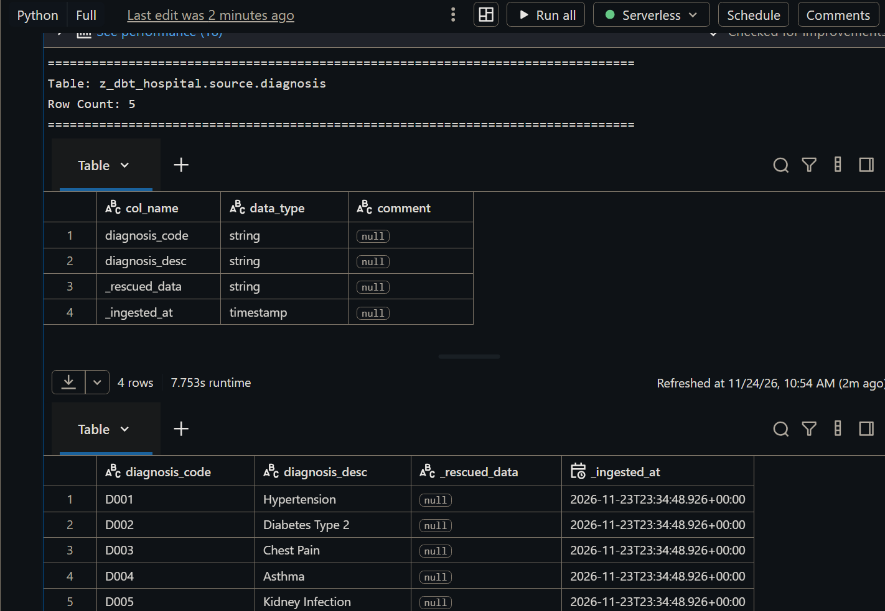
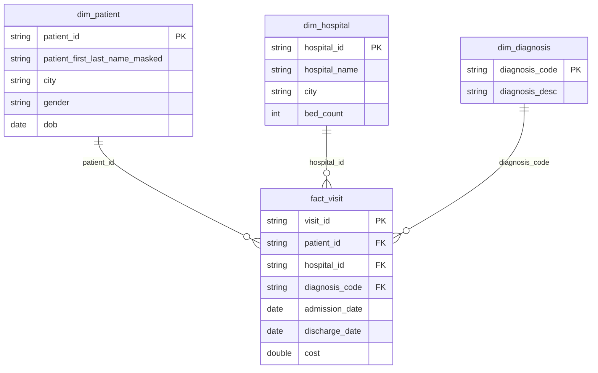
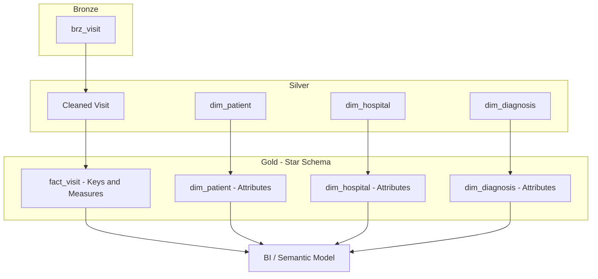
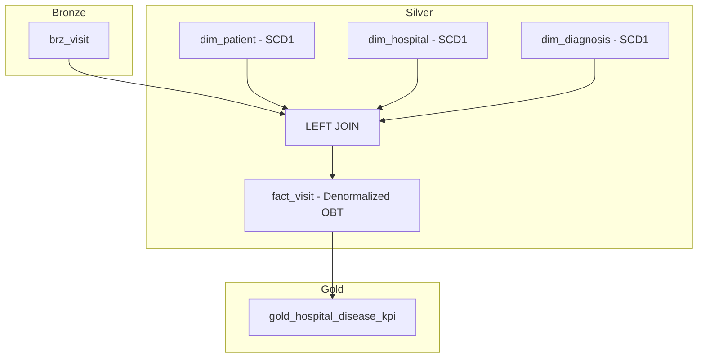
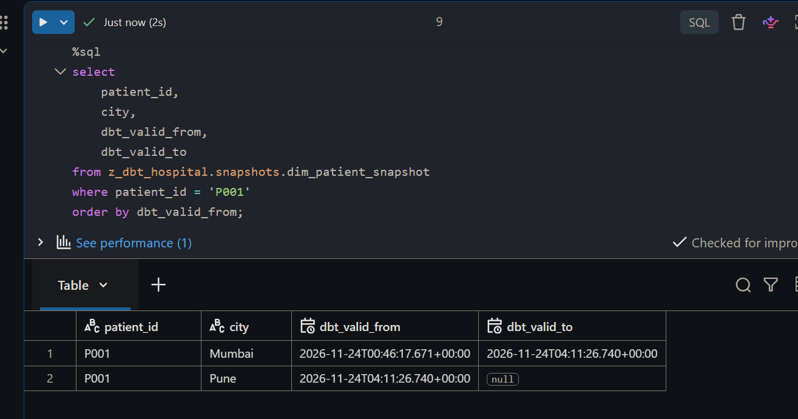

# Healthcare Data Pipeline with Databricks + dbt

An end-to-end data pipeline for a healthcare dataset, built on the **Medallion architecture** (Source → Bronze → Silver → Gold).

The pipeline:
- Ingests 4 CSV sources (diagnosis, hospital, patient, visit) from a Databricks Volume.
- Loads them into a `source` schema using **Auto Loader**.
- Amends schema and data types in a **Bronze** layer (dbt).
- Builds dimensional models (SCD1) in a **Silver** layer (dbt).
- Maintains patient attribute history using a **dbt Snapshot (SCD2)** alongside the current-state Silver dimension.
- Produces a KPI table for 30-day readmission analysis in a **Gold** layer (dbt).

---

## Business Context

**Organization:** ApexLife Hospitals — a multi-hospital network across several cities, serving thousands of patients every month.

**Problem:** The network has observed a growing issue of patients being **readmitted within 30 days of discharge**. These readmissions create multiple challenges:

1. **Financial Impact**
   Some readmissions may affect reimbursement under applicable payment and quality programs; not every readmission is avoidable or a treatment failure.

2. **Operational Pressure**
   Readmissions reduce bed availability for new patients.

3. **Patient Outcomes & Experience**
   High readmission rates impact patient trust in the hospital.

**Goal of this project:** Build an end-to-end data pipeline that identifies **30-day readmissions** across hospitals and diagnoses, so that the hospital network can monitor and reduce them.

## 1. Data Sources

Four CSVs are stored in a Databricks Volume:

```
/Volumes/z_dbt_hospital/source/raw_data_source/
├── diagnosis/    ← diagnosis.csv
├── hospital/     ← hospital.csv
├── patient/      ← patient.csv
└── visit/        ← visit.csv
```

| Source | Rows | Key | Description |
| :--- | :--- | :--- | :--- |
| diagnosis | 5 | diagnosis_code (D001–D005) | Diagnosis code + description |
| hospital | 5 | hospital_id (H001–H005) | Hospital name, city, bed count |
| patient | 5 | patient_id (P001–P005) | Patient name, gender, DOB, city |
| visit | 8 | visit_id (V1001–V1008) | Visit details: patient, hospital, diagnosis, cost, dates |

---

## 2. Source Layer: Auto Loader Ingestion

Each CSV is ingested into the `z_dbt_hospital.source` schema using **Auto Loader** (`cloudFiles`).

### Auto Loader Code

```python
from pyspark.sql.functions import current_timestamp

sources = [
    {"name": "diagnosis", "src": "/Volumes/z_dbt_hospital/source/raw_data_source/diagnosis/"},
    {"name": "hospital",  "src": "/Volumes/z_dbt_hospital/source/raw_data_source/hospital/"},
    {"name": "patient",   "src": "/Volumes/z_dbt_hospital/source/raw_data_source/patient/"},
    {"name": "visit",     "src": "/Volumes/z_dbt_hospital/source/raw_data_source/visit/"},
]

meta_base = "/Volumes/z_dbt_hospital/source/ingestion_metadata"

for s in sources:
    table_name = f"z_dbt_hospital.source.{s['name']}"
    checkpoint = f"{meta_base}/{s['name']}/checkpoint/"
    schema_loc = f"{meta_base}/{s['name']}/schema/"

    df = (spark.readStream
        .format("cloudFiles")
        .option("cloudFiles.format", "csv")
        .option("header", "true")
        .option("cloudFiles.inferColumnTypes", "false")
        .option("cloudFiles.schemaLocation", schema_loc)
        .load(s["src"])
    )

    query = (df
        .withColumn("_ingested_at", current_timestamp())
        .writeStream
        .format("delta")
        .option("checkpointLocation", checkpoint)
        .outputMode("append")
        .trigger(availableNow=True)
        .toTable(table_name)
    )
    query.awaitTermination()
```

### Key Points

| Option | Purpose |
| :--- | :--- |
| `cloudFiles.format = "csv"` | Read CSV |
| `header = "true"` | Use first row as header |
| `cloudFiles.inferColumnTypes = "false"` | Keep CSV fields as strings for explicit downstream casting |
| `cloudFiles.schemaLocation` | Stores schema evolution history |
| `checkpointLocation` | Tracks ingestion progress |
| `trigger(availableNow=True)` | Process once, then stop |
| `_ingested_at` | Ingestion timestamp (added at Source ingestion time) |

### Resulting Source Tables

```
z_dbt_hospital.source
├── diagnosis
├── hospital
├── patient
└── visit
```

All columns are `string`. `_ingested_at` is a `timestamp`. `_rescued_data` is present but not used downstream.

---

## 3. Bronze Layer: Schema Amendment (dbt)

The Bronze layer (`z_dbt_hospital.bronze`) amends the raw `string` columns into proper types.

### Model: `brz_diagnosis`

```sql
SELECT
    diagnosis_code,
    diagnosis_desc,
    _ingested_at
FROM {{ source('hospital_source', 'diagnosis') }}
```

### Model: `brz_hospital`

```sql
SELECT
    hospital_id,
    hospital_name,
    city,
    CAST(bed_count AS INT) AS bed_count,
    _ingested_at
FROM {{ source('hospital_source', 'hospital') }}
```

### Model: `brz_patient`

```sql
SELECT
    patient_id,
    first_name,
    last_name,
    gender,
    CAST(dob AS DATE) AS dob,
    city,
    _ingested_at
FROM {{ source('hospital_source', 'patient') }}
```

### Model: `brz_visit`

```sql
SELECT
    visit_id,
    patient_id,
    hospital_id,
    CAST(admission_date AS DATE) AS admission_date,
    CAST(discharge_date AS DATE) AS discharge_date,
    diagnosis_code,
    CAST(cost AS DOUBLE) AS cost,
    _ingested_at
FROM {{ source('hospital_source', 'visit') }}
```

### Key Points

- **`_rescued_data` is dropped** (Auto Loader fault-tolerance column).
- **`_ingested_at` is preserved** (audit column).
- **IDs remain `STRING`** because they contain prefixes (V, P, H, D).
- **Only numeric fields and dates are `CAST`.**

### `sources.yml`

```yaml
version: 2

sources:
  - name: hospital_source
    catalog: "{{ target.catalog }}"
    schema: source
    tables:
      - name: diagnosis
      - name: hospital
      - name: patient
      - name: visit
```

### Bronze Layer Validation — Dynamic Table Inspection

A reusable PySpark utility is used to dynamically discover and inspect all tables within a given catalog and schema, without manually specifying table names.

```python
catalog = "z_dbt_hospital"
schema = ["source", "bronze", "silver", "gold", "snapshots"]

tables = spark.sql(f"SHOW TABLES IN {catalog}.{schema}").collect()

for table in tables:
    full_name = f"{catalog}.{schema}.{table.tableName}"
    df = spark.table(full_name)

    print("=" * 80)
    print(f"Table: {full_name}")
    print(f"Row Count: {df.count()}")
    print("=" * 80)

    display(spark.sql(f"DESCRIBE TABLE {full_name}"))
    display(df)
```

#### Validation Objectives

| Validation | Purpose |
| :--- | :--- |
| Dynamic Table Discovery | Automatically discovers tables without hardcoded table names |
| Row Count | Supports row count reconciliation between layers |
| Schema Inspection | Verifies data types after Bronze transformations |
| Data Preview | Supports manual inspection of transformed records |
| Reusability | Works across different catalogs, schemas and projects |

#### Cross-Layer Reusability

The same utility can be reused by changing the `schema` parameter.

| Schema | Validation Purpose |
| :--- | :--- |
| `source` | Raw ingestion inspection |
| `bronze` | Data type validation |
| `silver` | Dimensional model inspection |
| `gold` | Business KPI inspection |
| `snapshots` | SCD2 historical version inspection |

The `catalog` parameter can also be changed between development and production environments.

#### Execution Evidence

The following screenshot demonstrates the dynamic table inspection utility running against the Source layer in Databricks.



The inspection of `source.diagnosis` confirms:

- Row count: 5 records.
- Raw business columns are stored as STRING.
- `_ingested_at` is stored as TIMESTAMP.
- `_rescued_data` is NULL for all five records.
- Table metadata, schema and data preview are displayed automatically.

The same utility is reused to inspect the Bronze, Silver, Gold and Snapshot layers.

**Design Rationale:** This metadata-driven approach reduces repetitive SQL queries and provides a consistent inspection method across pipeline layers and environments.

**Limitation:** This utility is intended for interactive development and manual inspection. For large production tables, full row counts can be expensive. Data previews should be limited using `display(df.limit(20))`. Automated data quality enforcement is handled separately through dbt tests.

---

## 4. Silver Layer: Dimensional Models (SCD1)

The Silver layer (`z_dbt_hospital.silver`) contains **3 dimensions + 1 fact table**, built with **dbt incremental models using SCD1** semantics.

### SCD1 Implementation

All Silver models use:

```sql
{{ config(
    materialized='incremental',
    unique_key='<primary_key>',
    incremental_strategy='merge'
) }}
```

- **`materialized='incremental'`**: Enables incremental execution; the explicit filter selects incoming rows.
- **`unique_key`**: Identifies which row is "the same entity".
- **`incremental_strategy='merge'`**: **SCD1** — matched rows updated, unmatched rows inserted.

### Incremental Filter

```sql

WHERE _ingested_at > (
    SELECT COALESCE(MAX(_ingested_at), '1900-01-01') FROM {{ this }}
)

```

### Deduplication

```sql
QUALIFY ROW_NUMBER() OVER (
    PARTITION BY <primary_key>
    ORDER BY _ingested_at DESC
) = 1
```

### `dim_diagnosis`

```sql
{{ config(
    materialized='incremental',
    unique_key='diagnosis_code',
    incremental_strategy='merge'
) }}

SELECT
    diagnosis_code,
    diagnosis_desc,
    _ingested_at,
    current_timestamp() as silver_load_timestamp
FROM {{ ref('brz_diagnosis') }}

WHERE _ingested_at > (
    SELECT COALESCE(MAX(_ingested_at), '1900-01-01') FROM {{ this }}
)

QUALIFY ROW_NUMBER() OVER (PARTITION BY diagnosis_code ORDER BY _ingested_at DESC) = 1
```

### `dim_hospital`

```sql
{{ config(
    materialized='incremental',
    unique_key='hospital_id',
    incremental_strategy='merge'
) }}

SELECT
    hospital_id,
    hospital_name,
    city,
    bed_count,
    _ingested_at,
    current_timestamp() as silver_load_timestamp
FROM {{ ref('brz_hospital') }}

WHERE _ingested_at > (
    SELECT COALESCE(MAX(_ingested_at), '1900-01-01') FROM {{ this }}
)

QUALIFY ROW_NUMBER() OVER (PARTITION BY hospital_id ORDER BY _ingested_at DESC) = 1
```

### `dim_patient`

Patient names are pseudonymized: `first_name` and `last_name` are concatenated and hashed with SHA-256.

```sql
{{ config(
    materialized='incremental',
    unique_key='patient_id',
    incremental_strategy='merge'
) }}

SELECT
    patient_id,
    gender,
    dob,
    city,
    SHA2(CONCAT_WS('|', first_name, last_name), 256) AS patient_first_last_name_masked,
    _ingested_at,
    current_timestamp() as silver_load_timestamp
FROM {{ ref('brz_patient') }}

WHERE _ingested_at > (
    SELECT COALESCE(MAX(_ingested_at), '1900-01-01') FROM {{ this }}
)

QUALIFY ROW_NUMBER() OVER (PARTITION BY patient_id ORDER BY _ingested_at DESC) = 1
```

**Note:** `first_name` and `last_name` are NOT selected — they are replaced by `patient_first_last_name_masked`.

### `fact_visit`

Joins `visit` with the 3 dimensions.

```sql
{{ config(
    materialized='incremental',
    unique_key='visit_id',
    incremental_strategy='merge'
) }}

WITH
    visit AS (
        SELECT *
        FROM {{ ref('brz_visit') }}
        
        WHERE _ingested_at > (
            SELECT COALESCE(MAX(_ingested_at), '1900-01-01') FROM {{ this }}
        )
        
        QUALIFY ROW_NUMBER() OVER (PARTITION BY visit_id ORDER BY _ingested_at DESC) = 1
    ),
    patient   AS (SELECT * FROM {{ ref('dim_patient') }}),
    hospital  AS (SELECT * FROM {{ ref('dim_hospital') }}),
    diagnosis AS (SELECT * FROM {{ ref('dim_diagnosis') }})

SELECT
    v.visit_id,
    v.patient_id,
    v.hospital_id,
    v.admission_date,
    v.discharge_date,
    v.diagnosis_code,
    v.cost,
    v._ingested_at,

    p.patient_first_last_name_masked,
    p.city AS patient_city,
    p.gender,
    p.dob,

    h.hospital_name,
    h.city AS hospital_city,
    h.bed_count,

    d.diagnosis_desc,
    CURRENT_TIMESTAMP() AS silver_load_timestamp
FROM visit v
LEFT JOIN patient   p ON v.patient_id    = p.patient_id
LEFT JOIN hospital  h ON v.hospital_id   = h.hospital_id
LEFT JOIN diagnosis d ON v.diagnosis_code = d.diagnosis_code
```

## Silver Layer — Dimensional Modeling & Referential Integrity

The Silver layer consists of three independently maintained
SCD Type 1 dimensions and one incrementally maintained,
denormalized OBT-style fact table.

This section compares a traditional star schema with the
current project's OBT-style implementation, highlighting
the differences in layer responsibilities, dimension
attributes, join strategies, and downstream consumption.

### Standard Star Schema — Reference Architecture

A traditional star schema separates business facts from
descriptive dimension attributes.

The fact table primarily contains:

- Business keys or surrogate keys.
- Foreign keys referencing dimension tables.
- Transactional dates.
- Business measures.

Descriptive attributes such as hospital_name, patient_city,
and diagnosis_desc remain in their respective dimension tables.

The following ERD illustrates a conventional star schema
as a reference architecture rather than the complete
physical schema implemented in this project.



In a conventional Medallion Architecture, cleaned fact
and dimension entities may be prepared in Silver and
published as a business-ready star schema in Gold.

Fact construction may involve dimension lookups or joins
to resolve surrogate keys. However, descriptive dimension
attributes are not duplicated in the fact table.



The Gold fact and dimension tables remain separate.
Analytical joins and aggregations can be performed by
SQL queries or BI semantic models.

Gold does not necessarily require pre-aggregation.

### Current Project — Silver OBT Architecture

Unlike the traditional star schema reference, this project
performs denormalization directly in the Silver layer.

The Bronze visit table is joined with three Silver
dimensions to construct an enriched fact table.



The Silver fact_visit table contains both transactional
facts and descriptive dimension attributes.

| Attribute Category | Columns |
| :--- | :--- |
| Primary Key | visit_id |
| Foreign Keys | patient_id, hospital_id, diagnosis_code |
| Transactional Dates | admission_date, discharge_date |
| Business Measures | cost |
| Patient Attributes | patient_first_last_name_masked, patient_city, gender, dob |
| Hospital Attributes | hospital_name, hospital_city, bed_count |
| Diagnosis Attributes | diagnosis_desc |
| Audit Metadata | _ingested_at, silver_load_timestamp |

The resulting table maintains one row per hospital visit
while providing the descriptive attributes required for
downstream analytical processing.

The Gold layer directly consumes this enriched fact table
without repeating the dimension joins.

### Layer Responsibilities & Attribute Distribution

Medallion Architecture defines data processing layers,
whereas star schema and OBT define data modeling strategies.

These concepts are independent. A star schema or an OBT
can be implemented in Silver or Gold depending on the
architecture and business requirements.

| Layer | Traditional Gold Star Schema | Gold OBT Alternative | Current Project |
| :--- | :--- | :--- | :--- |
| Bronze | Cleaned source tables | Cleaned source tables | Cleaned source tables |
| Silver Dimensions | Independent dimensions | Independent dimensions | SCD Type 1 dimensions |
| Silver Fact | Keys and measures | Keys and measures | Keys, measures and dimension attributes |
| Gold Fact | Keys and measures | Denormalized OBT | Not required |
| Gold Dimensions | Separate dimension tables | Embedded in OBT | Not required |
| Dimension JOIN | Fact key resolution or analytical queries | Gold transformation | Silver transformation |
| Business Aggregation | SQL or BI semantic model | SQL, BI or KPI marts | Gold KPI table |

The current Silver fact_visit is therefore functionally
similar to a Gold OBT in an alternative architecture.

The main difference is that denormalization is performed
earlier in the pipeline.

### Design Comparison — Star Schema vs OBT

| Aspect | Traditional Star Schema | Current OBT-style Design |
| :--- | :--- | :--- |
| Fact Grain | One row per visit | One row per visit |
| Foreign Keys | Retained | Retained |
| Dimension Attributes | Stored separately | Embedded in fact table |
| Denormalization | Not required | Performed in Silver |
| Analytical Joins | Required when accessing dimension attributes | Not required for existing attributes |
| Data Redundancy | Lower | Higher |
| Downstream SQL | May require dimension joins | Direct filtering and aggregation |
| Dimension Change Propagation | Latest attributes available through SCD1 dimension joins | Requires fact reprocessing |
| Referential Integrity | Required | Required |
| Typical Consumption | BI semantic models and dimensional warehouses | SQL analytics and KPI marts |

Both approaches are valid data modeling strategies.

The current project intentionally performs denormalization
in Silver to simplify downstream Gold transformations.

### Model Grain and Update Strategy

| Model | Layer | Grain | Business Key | Update Strategy |
| :--- | :--- | :--- | :--- | :--- |
| dim_patient | Silver | One row per patient | patient_id | SCD Type 1 |
| dim_hospital | Silver | One row per hospital | hospital_id | SCD Type 1 |
| dim_diagnosis | Silver | One row per diagnosis | diagnosis_code | SCD Type 1 |
| fact_visit | Silver | One row per hospital visit | visit_id | Incremental Upsert |

All four Silver models use incremental MERGE processing.

The dimension models maintain the latest business state
without retaining historical versions.

Historical patient changes are tracked separately through
dbt snapshots using SCD Type 2.

### Audit Timestamps

| Column | Purpose |
| :--- | :--- |
| `_ingested_at` | Original ingestion timestamp used for incremental filtering and deduplication |
| `silver_load_timestamp` | Silver processing timestamp used for auditing and pipeline monitoring |

The original ingestion timestamp is preserved throughout
Silver processing.

The silver_load_timestamp records when a record is
inserted or updated in the Silver layer.

### PII Protection

Original patient names are retained in the Source and
Bronze layers, where access should be restricted.

In the Silver layer, first_name and last_name are excluded
from the output and replaced with a SHA256 hash.

The denormalized fact table inherits the hashed patient
name rather than the original personally identifiable
information.

The Gold KPI table does not require patient names or
hashed patient names.

| Layer | Original Patient Names | Hashed Patient Name |
| :--- | :--- | :--- |
| Source | Retained | Not required |
| Bronze | Retained | Not required |
| Silver Dimensions | Removed | Retained in dim_patient |
| Silver Fact | Removed | Retained |
| Snapshot | Removed | Retained |
| Gold | Removed | Not required |

Hashing provides pseudonymization rather than complete
anonymization. Appropriate access controls remain necessary.

### Design Rationale

The denormalized fact table simplifies downstream
analytical processing by incorporating descriptive
dimension attributes during Silver loading.

Independent dimension tables are retained to support:

- SCD Type 1 dimension management.
- Reusable and standardized business entities.
- Primary key and foreign key validation.
- Referential integrity testing.
- SCD Type 2 historical tracking for patient attributes.

The Gold layer focuses on business-specific KPI
calculations and aggregations rather than repeating
dimension enrichment.

### Design Trade-offs & Known Limitations

Denormalization introduces data redundancy and additional
storage requirements.

Because fact_visit is incrementally processed using the
visit ingestion timestamp, changes to dimension attributes
alone do not automatically refresh existing fact records.

For example, updating a patient's city in dim_patient
does not automatically update patient_city in existing
fact_visit records.

Potential improvements include:

- Dimension change propagation.
- Reprocessing affected fact records.
- Incremental lookback windows.
- Separating the standard fact table from the enriched OBT.

### ERD vs Data Lineage

The reference ERD illustrates the conventional logical
primary key and foreign key relationships between
fact and dimension tables.

The current project's data lineage illustrates the
physical transformation process used to construct
the denormalized Silver fact table.

Although the current fact table already contains
dimension attributes, its foreign keys remain available
for referential integrity validation.

These logical relationships do not imply that dimension
joins must be repeated in downstream Gold transformations.

### Silver Layer — Data Quality Testing

Data quality tests are defined using dbt generic tests to
validate primary keys, foreign keys, and referential integrity
before downstream Gold transformations.

#### Test Coverage

| Model | Column | Data Quality Tests |
| :--- | :--- | :--- |
| dim_diagnosis | diagnosis_code | unique, not_null |
| dim_hospital | hospital_id | unique, not_null |
| dim_patient | patient_id | unique, not_null |
| fact_visit | visit_id | unique, not_null |
| fact_visit | patient_id | not_null, relationships |
| fact_visit | hospital_id | not_null, relationships |
| fact_visit | diagnosis_code | not_null, relationships |

A total of 14 generic data quality tests are defined.

#### Test Configuration

File: `models/silver/schema.yml`

```yaml
version: 2

models:
  - name: dim_diagnosis
    description: "SCD Type 1 diagnosis dimension"
    columns:
      - name: diagnosis_code
        data_tests:
          - unique
          - not_null

  - name: dim_hospital
    description: "SCD Type 1 hospital dimension"
    columns:
      - name: hospital_id
        data_tests:
          - unique
          - not_null

  - name: dim_patient
    description: "SCD Type 1 patient dimension with pseudonymized names"
    columns:
      - name: patient_id
        data_tests:
          - unique
          - not_null

  - name: fact_visit
    description: "Incrementally maintained hospital visit fact table"
    columns:
      - name: visit_id
        data_tests:
          - unique
          - not_null

      - name: patient_id
        data_tests:
          - not_null
          - relationships:
              arguments:
                to: ref('dim_patient')
                field: patient_id

      - name: hospital_id
        data_tests:
          - not_null
          - relationships:
              arguments:
                to: ref('dim_hospital')
                field: hospital_id

      - name: diagnosis_code
        data_tests:
          - not_null
          - relationships:
              arguments:
                to: ref('dim_diagnosis')
                field: diagnosis_code
```

#### Data Quality Objectives

| Test | Objective |
| :--- | :--- |
| unique | Validate that business keys contain no duplicate values |
| not_null | Ensure mandatory business keys are populated |
| relationships | Detect orphan foreign keys in the fact table |

The unique_key configuration used by incremental MERGE
does not automatically enforce uniqueness.

Explicit dbt tests are therefore required to validate
the resulting data.

LEFT JOIN operations preserve hospital visit records even
when a corresponding dimension record is missing.

Relationship tests detect these unmatched foreign keys
without silently discarding the original visit records.

#### Test Execution

```bash
dbt run --select silver
dbt test --select silver
```

Alternatively, model execution and testing can be combined:

```bash
dbt build --select silver
```

#### Expected Validation Results

| Test Category | Expected Tests |
| :--- | ---: |
| Uniqueness | 4 |
| Not Null | 7 |
| Referential Integrity | 3 |
| **Total** | **14** |

The expected outcome is 14 passing tests with no failures.

Actual execution results will be recorded after validation.

#### Design Considerations

- Incremental MERGE reduces unnecessary full-table processing.
- ROW_NUMBER deduplication retains the latest record per business key.
- SCD Type 1 dimensions maintain the latest business state.
- dbt snapshots provide separate SCD Type 2 historical tracking.
- SHA256 hashing reduces direct exposure of patient names.
- Audit timestamps improve pipeline observability.
- Generic data tests validate key integrity before Gold processing.

#### Known Limitations

The fact table contains denormalized dimension attributes.

Changes to dimension attributes alone do not automatically
refresh existing fact records unless the corresponding visit
is reprocessed.

The incremental watermark uses a strict greater-than condition.
Records arriving with an ingestion timestamp equal to or older
than the current watermark may be missed.

Potential enhancements include dimension change propagation,
lookback windows, and additional business rule validation.

---

## 5. Gold Layer: Hospital Disease KPI

The Gold layer (`z_dbt_hospital.gold`) contains one KPI table: `gold_hospital_disease_kpi`.

### Model: `gold_hospital_disease_kpi`

Built from `fact_visit`. Computes a **30-day readmission rate** per hospital and diagnosis.

### Readmission Logic

For this demonstration, a readmission is a visit starting 0–30 days after the immediately preceding visit for the same patient and diagnosis. This is a simplified visit-based indicator, not an official CMS risk-adjusted readmission measure. Cross-hospital readmissions are included and attributed to the receiving hospital.

Implementation:
1. For each patient and diagnosis (ordered by `admission_date`, then `visit_id`), use `LAG(discharge_date)` to get the previous discharge date.
2. Compute `days_since_last_visit = DATEDIFF(admission_date, previous_discharge)`.
3. Flag `is_readmission_30d = 1` when `days_since_last_visit` is between 0 and 30 inclusive, otherwise `0`.

### Model Code

```sql
{{ config(materialized='table') }}

with
    visit_with_prev as (
        select
            visit_id,
            patient_id,
            hospital_id,
            hospital_name,
            diagnosis_code,
            diagnosis_desc,
            admission_date,
            discharge_date,
            cost,
            lag(discharge_date) over (
                partition by patient_id, diagnosis_code order by admission_date
            ) as previous_discharge
        from {{ ref('fact_visit') }}
    ),
    visit_flagged as (
        select
            *,
            datediff(admission_date, previous_discharge) as days_since_last_visit,
            case
                when datediff(admission_date, previous_discharge) between 0 and 30
                then 1
                else 0
            end as is_readmission_30d
        from visit_with_prev
    )

select
    hospital_id,
    hospital_name,
    diagnosis_code,
    diagnosis_desc,
    count(*) as total_visits,
    sum(is_readmission_30d) as total_readmissions,
    round(sum(is_readmission_30d) * 1.0 / count(*), 3) as readmission_rate,
    round(sum(cost), 2) as total_cost,
    round(avg(cost), 2) as avg_cost,
    current_timestamp() as gold_load_timestamp
from visit_flagged
group by hospital_id, hospital_name, diagnosis_code, diagnosis_desc
```

### Output Schema

| Column | Description |
| :--- | :--- |
| `hospital_id` | Hospital identifier |
| `hospital_name` | Hospital name |
| `diagnosis_code` | Diagnosis identifier |
| `diagnosis_desc` | Diagnosis description |
| `total_visits` | Number of visits for this (hospital, diagnosis) pair |
| `total_readmissions` | Visits flagged as 30-day readmissions |
| `readmission_rate` | `total_readmissions / total_visits` |
| `total_cost` | Sum of costs |
| `avg_cost` | Average cost per visit |
| `gold_load_timestamp` | Gold table generation time |

### Gold Layer — Data Quality Testing

Unlike the Silver layer, which focuses on primary key
uniqueness and referential integrity, the Gold layer
focuses on business KPI validation and aggregation integrity.

#### Generic Tests

File: `models/gold/schema.yml`

```yaml
version: 2

models:
  - name: gold_hospital_disease_kpi
    description: "Hospital and diagnosis level KPI aggregation"

    columns:
      - name: hospital_id
        data_tests:
          - not_null

      - name: diagnosis_code
        data_tests:
          - not_null

      - name: total_visits
        data_tests:
          - not_null

      - name: total_readmissions
        data_tests:
          - not_null

      - name: readmission_rate
        data_tests:
          - not_null
```

The intended Gold model grain is one row per hospital
per diagnosis.

Neither hospital_id nor diagnosis_code is individually
unique because each hospital may have multiple diagnoses.

#### Singular Test — Business Rule Validation

File: `tests/assert_hospital_kpi_valid.sql`

```sql
select *
from {{ ref('gold_hospital_disease_kpi') }}
where
    total_visits <= 0
    or total_readmissions < 0
    or total_readmissions > total_visits
    or readmission_rate < 0
    or readmission_rate > 1
    or total_cost < 0
```

This singular test validates the logical consistency
of the aggregated business metrics.

A dbt singular test passes when the query returns zero rows.

#### Business Validation Rules

| KPI | Validation Rule |
| :--- | :--- |
| total_visits | Must be greater than zero |
| total_readmissions | Must be non-negative |
| total_readmissions | Must not exceed total_visits |
| readmission_rate | Must be between 0 and 1 |
| total_cost | Must be non-negative |

#### Test Execution

```bash
dbt run --select gold
dbt test --select gold
```

Alternatively:

```bash
dbt build --select gold
```

#### Expected Validation Results

| Test Category | Expected Tests |
| :--- | ---: |
| Generic Tests (not_null) | 5 |
| Singular Test (Business Rules) | 1 |
| **Total** | **6** |

Actual execution results will be recorded after validation.

#### Cross-Layer Data Quality Strategy

| Layer | Validation Focus | Test Type | Number of Tests |
| :--- | :--- | :--- | ---: |
| Silver | Primary Key Uniqueness | unique | 4 |
| Silver | Mandatory Keys | not_null | 7 |
| Silver | Referential Integrity | relationships | 3 |
| Gold | Mandatory KPI Fields | not_null | 5 |
| Gold | Business Rule Validation | Singular Test | 1 |
| **Total** | | | **20** |

The testing strategy separates structural data quality
from business-level validation.

Silver tests ensure that the underlying entities and
relationships are valid, while Gold tests ensure that
the aggregated KPIs satisfy the defined business rules.

This provides automated data quality validation across
the transformation pipeline without requiring additional
dbt packages.

### BI Questions Answered

The Gold grain is hospital and diagnosis (assuming consistent dimension labels). Hospital-level rates must be calculated from summed counts, not averaged diagnosis-level rates. The following revised queries should be rerun against the updated Gold model; previous sample results are not treated as verified results for the revised logic.

#### Q1: Which hospital has the highest readmission rate?

```sql
SELECT hospital_id, hospital_name,
       SUM(total_readmissions) AS total_readmissions,
       SUM(total_visits) AS total_visits,
       ROUND(SUM(total_readmissions) * 1.0 / NULLIF(SUM(total_visits), 0), 3) AS readmission_rate
FROM z_dbt_hospital.gold.gold_hospital_disease_kpi
GROUP BY hospital_id, hospital_name
ORDER BY readmission_rate DESC;
```

#### Q2: Which disease has the most readmissions?

```sql
SELECT diagnosis_code, diagnosis_desc, SUM(total_readmissions) AS total_readm
FROM z_dbt_hospital.gold.gold_hospital_disease_kpi
GROUP BY diagnosis_code, diagnosis_desc
ORDER BY total_readm DESC;
```

#### Q3: Which hospital has the highest rate for Chest Pain?

```sql
SELECT *
FROM z_dbt_hospital.gold.gold_hospital_disease_kpi
WHERE diagnosis_desc = 'Chest Pain'
ORDER BY readmission_rate DESC;
```

#### Q4: Which hospital spends the most?

```sql
SELECT hospital_id, hospital_name, SUM(total_cost) AS total_cost
FROM z_dbt_hospital.gold.gold_hospital_disease_kpi
GROUP BY hospital_id, hospital_name
ORDER BY total_cost DESC;
```

The reference tutorial uses `diagnosis_category`, which is not present in this dataset. This project uses diagnosis codes and descriptions. With only eight original visits, these results illustrate the pipeline rather than establish clinical performance.

---

## 6. Architecture Summary

```
Volume: /Volumes/z_dbt_hospital/source/raw_data_source/
    │
    │ Auto Loader (readStream → writeStream, availableNow=True)
    ▼
Schema: z_dbt_hospital.source      ← raw data, all string, has _ingested_at
    │
    │ dbt Bronze (brz_*)
    ▼
Schema: z_dbt_hospital.bronze      ← typed raw data
    │
    │ dbt Silver (dim_*, fact_*)
    ▼
Schema: z_dbt_hospital.silver      ← 3 dims + 1 fact
    ├── dim_diagnosis
    ├── dim_hospital
    ├── dim_patient ── dbt snapshot ──► snapshots.dim_patient_snapshot (SCD2)
    └── fact_visit
    │
    │ dbt Gold (gold_hospital_disease_kpi)
    ▼
Schema: z_dbt_hospital.gold        ← KPI table
    └── gold_hospital_disease_kpi
```

---

## 7. Key Design Decisions

| Decision | Rationale |
| :--- | :--- |
| **Auto Loader writes to `source`, not `bronze`** | Keeps "raw ingestion" separate from "typed/amended data" |
| **`_ingested_at` added at Source ingestion time** | Audit column + deduplication ordering key |
| **`_rescued_data` dropped** | Not selected downstream; retain in Source for investigation |
| **IDs remain `STRING`** | Contain prefixes (V/P/H/D), not pure numbers |
| **dbt Bronze = type casting only** | Separation of concerns |
| **Silver uses SCD1 (merge)** | Current-state dimensions; patient history is maintained separately |
| **`incremental_strategy='merge'`** | Makes it SCD1, not append |
| **Patient name hashed with SHA-256** | Pseudonymization, not anonymization |
| **Patient SCD2 snapshot** | Track selected attribute changes without changing the current-state fact pipeline |
| **Gold uses LAG + DATEDIFF** | Project-specific 0–30-day readmission window |

---

## 8. Differences from the Reference Implementation

This project follows the same Medallion architecture as the reference tutorial (Databricks notebooks + MERGE), but applies **dbt** for the transformation layer.

### 8.1 Transformation Tool: dbt instead of Databricks Notebooks

| Aspect | Reference | This Project |
| :--- | :--- | :--- |
| **Transform language** | PySpark + DeltaTable.merge() | SQL + dbt incremental models |
| **Version control** | Notebook (JSON) | Plain `.sql` files (Git-friendly) |
| **Testing** | Manual | `dbt test` (built-in) |
| **Docs** | Manual | `dbt docs generate` |
| **Dependency management** | Manual | Automatic (`{{ ref(...) }}`) |
| **Incremental logic** | `foreachBatch` + checkpoint | `incremental_strategy='merge'` |

### 8.2 SCD1 Implementation

| Aspect | Reference | This Project |
| :--- | :--- | :--- |
| **Dedup method** | `dropDuplicates([key])` | `ROW_NUMBER() OVER (PARTITION BY key ORDER BY _ingested_at DESC) = 1` |
| **Upsert method** | `DeltaTable.merge(...)` | dbt `incremental_strategy='merge'` |
| **Incremental trigger** | `readStream` (streaming) | `` (batch) |

> **Under the hood:** dbt's `incremental_strategy='merge'` compiles to a Delta Lake `MERGE INTO` statement — the same primitive used in the reference implementation (via `DeltaTable.merge()`). The difference is that dbt *declares* this behavior once via config, rather than writing the merge logic imperatively per model.
>
> Reference: [Databricks docs — Upsert into a Delta Lake table using merge](https://docs.databricks.com/aws/en/delta/merge)

#### SCD1 and SCD2 coexist in this project

The three Silver dimensions retain one current row per business key using incremental MERGE. `fact_visit` retains one row per visit and supports corrections through upsert. The patient snapshot separately records historical versions of selected patient attributes. Hospital and diagnosis history are outside the current snapshot scope.

#### SCD2 in dbt: `dim_patient_snapshot`

The snapshot reads the deduplicated, pseudonymized `dim_patient` rather than the append-only raw source. This prevents multiple source rows per patient from reaching the snapshot in one run.

| Strategy | Requirement | Change detection |
| :--- | :--- | :--- |
| `timestamp` | Reliable update timestamp | Newer update timestamp |
| `check` | Selected attributes | Comparison of attribute values |

The source has no business `updated_at`, so the project uses `check`. `_ingested_at` is retained for lineage but excluded from change detection.

**File:** `snapshots/dim_patient_snapshot.sql`

```sql


{{ config(
    target_database=target.catalog,
    target_schema='snapshots',
    unique_key='patient_id',
    strategy='check',
    check_cols=['city', 'gender', 'dob', 'patient_first_last_name_masked']
) }}

SELECT
    patient_id,
    gender,
    dob,
    city,
    patient_first_last_name_masked,
    _ingested_at
FROM {{ ref('dim_patient') }}


```

The SQL snapshot uses the legacy target configuration syntax; confirm the resolved catalog and schema with the installed dbt-databricks version before running in prod.

```bash
dbt run --target dev --select +dim_patient
dbt snapshot --target dev --select dim_patient_snapshot
```

| Column | Purpose |
| :--- | :--- |
| `dbt_scd_id` | Identifier for a historical version |
| `dbt_updated_at` | Snapshot change timestamp |
| `dbt_valid_from` | Start of observed version |
| `dbt_valid_to` | End of observed version; NULL means current |

New patients are inserted; changed attributes close the previous version and create a new current version. Unchanged attributes do not create a new version.

#### SCD2 validation procedure

Run the initial snapshot, then append a controlled patient-city change in dev. Use explicit column names because the source may contain `_rescued_data`.

```sql
INSERT INTO z_dbt_hospital.source.patient
    (patient_id, first_name, last_name, gender, dob, city, _ingested_at)
SELECT patient_id, first_name, last_name, gender, dob,
       CONCAT(city, ' - SCD2 test'), CURRENT_TIMESTAMP()
FROM z_dbt_hospital.source.patient
WHERE patient_id = 'P001'
QUALIFY ROW_NUMBER() OVER (ORDER BY _ingested_at DESC) = 1;
```

```bash
dbt run --target dev --select +dim_patient
dbt snapshot --target dev --select dim_patient_snapshot
```

```sql
SELECT patient_id, city, dbt_valid_from, dbt_valid_to
FROM z_dbt_hospital.snapshots.dim_patient_snapshot
WHERE patient_id = 'P001'
ORDER BY dbt_valid_from;
```

#### SCD Type 2 — Incremental Change Validation

An incremental CSV file was uploaded to update patient
P001's city from Mumbai to Pune.

The dbt snapshot successfully detected the attribute
change, closed the historical record, and created a
new current record.

**Actual Validation Results:**

| Patient ID | City | Status | dbt_valid_to |
| :--- | :--- | :--- | :--- |
| P001 | Mumbai | Historical | 2026-11-24 04:11:26.740 UTC |
| P001 | Pune | Current | NULL |

The historical record's `dbt_valid_to` matches the new
record's `dbt_valid_from`, confirming continuous
version history without temporal gaps.



Rerunning the snapshot without changes to the tracked
attributes should not create another historical version.

#### Snapshot limitations

- Snapshot validity reflects observation time, not the actual business-effective time.
- Intermediate changes overwritten in SCD1 between snapshot runs are not captured. Historical backfill from retained Source observations would be a separate process.
- The fact does not join to historical patient versions; this snapshot is an independent history table, not a point-in-time fact enrichment.
- Hashing names does not anonymize patient IDs, DOB or other identifying attributes. Restrict access to Source, Bronze and snapshots; use synthetic data for public demonstrations.


### 8.3 Improvement: Fact Table Deduplication

**Reference:** `fact_visit` is built by joining `visit` with the 3 dimensions, then MERGEd. **No explicit deduplication** on `visit_id`.

**This project:** adds:

```sql
QUALIFY ROW_NUMBER() OVER (PARTITION BY visit_id ORDER BY _ingested_at DESC) = 1
```

**Why:** different files may contain repeated or corrected visit IDs. Auto Loader checkpointing tracks files, not business-key uniqueness. Multiple source rows for one key can cause ambiguous MERGE matches or duplicate inserts.

**Conclusion:** the reference is **pedagogically simplified**. This project explicitly deduplicates incoming business keys, although equal timestamps still require a reliable tie-breaker.

### 8.4 Job Orchestration: dbt run vs. Asset Bundle

The reference implementation uses **Databricks Asset Bundle** (`reference_bundle_job_file.yml`) to define an end-to-end Job with 8 Notebook tasks and `depends_on` dependencies.

This project uses **dbt CLI and its dependency DAG** for transformation execution. External scheduling of ingestion and dbt is separate:

```bash
dbt run --select bronze
dbt run --select silver
dbt snapshot
dbt run --select gold
dbt test
```

| Aspect | Reference (Asset Bundle) | This Project (dbt run) |
| :--- | :--- | :--- |
| **Definition** | YAML (`reference_bundle_job_file.yml`) | CLI commands |
| **Dependencies** | `depends_on` in YAML | Implicit in `{{ ref() }}` DAG |
| **Deployment** | `databricks bundle deploy` | Target-specific dbt CLI; automated CI/CD is not demonstrated here |
| **Testing** | Separate Notebook | `dbt test` (built-in) |

**Both approaches are valid.** Asset Bundle is suitable for teams managing many Notebook-based Jobs. dbt is suitable for SQL-heavy transformations with built-in lineage and testing.

### 8.5 Architecture Comparison — Streaming vs. Hybrid Processing

The reference implementation uses Structured Streaming
for raw data ingestion and Bronze-to-Silver processing.

This project adopts a hybrid architecture that combines
streaming ingestion with batch-based dbt transformations.

#### Reference Architecture

```text
Raw CSV (ADLS)
    |
    | Auto Loader + Checkpoint
    v
Bronze (Raw Delta Tables)
    |
    | Structured Streaming + Checkpoint
    v
Silver (Dimensions / Fact)
    |
    | Downstream Transformation
    v
Gold (Business KPIs)
```

#### This Project

```text
Raw CSV (Databricks Volume)
    |
    | Auto Loader + Checkpoint
    v
Source (Raw Delta Tables)
    |
    | dbt Schema Casting
    v
Bronze (Typed Schema)
    |
    | dbt Incremental MERGE
    | Watermark: MAX(_ingested_at)
    v
Silver (SCD1 Dimensions + OBT)
    |
    +-------------------------+
    |                         |
    | dbt snapshot            | dbt Table Rebuild
    v                         v
Snapshots (SCD2)         Gold (Business KPIs)
```

#### Checkpoint vs. Watermark

| Aspect | Reference | This Project |
| :--- | :--- | :--- |
| Architecture | Streaming-based | Hybrid |
| Raw Delta Layer | Bronze | Source |
| Schema Casting | Downstream Transformation | Dedicated Bronze Layer |
| Ingestion Tracking | Auto Loader Checkpoint | Auto Loader Checkpoint |
| Downstream Incremental Tracking | Streaming Checkpoint | SQL Watermark |
| Progress Storage | Checkpoint Files | MAX(_ingested_at) in Target Table |
| Checkpoint Management | Per Independent Streaming Query | Ingestion Only |
| Transformation Execution | Streaming / Micro-batch | Batch |

Each independent Structured Streaming query requires
its own checkpoint to track processing progress and
support recovery.

This project maintains four independent checkpoints
for Source ingestion: diagnosis, hospital, patient,
and visit.

Downstream incremental processing is managed by dbt
using `_ingested_at` as a watermark, without requiring
additional streaming checkpoints.

#### Design Trade-offs

The hybrid architecture provides:

- Separation of raw ingestion and schema standardization.
- Reduced downstream streaming checkpoint management.
- SQL-based transformations and dimensional modeling.
- Integration with dbt testing, snapshots, and lineage.
- Suitability for scheduled analytical workloads.

However, watermark-based processing requires careful
handling of late-arriving records and timestamp boundaries.
Periodic snapshots may also miss intermediate changes.

Streaming-based processing is more suitable when
low-latency data availability is required, although
it introduces additional streaming state management.

**Key principle: Incremental processing does not
necessarily require streaming.**

For this hospital analytics workload, batch-based
transformations provide sufficient data freshness
while reducing downstream streaming complexity.

## 9. How to Run

```bash
# 1. Ingest raw CSVs into `source` schema
# (Run the Auto Loader notebook once)

# 2. Run dbt Bronze models
dbt run --select bronze

# 3. Run dbt Silver models
dbt run --select silver

# 4. Capture patient history
dbt snapshot --select dim_patient_snapshot

# 5. Run dbt Gold models
dbt run --select gold

# 6. Test
dbt test

```

## 10. Deployment

### 10.1 Multi-Environment Setup

The project uses **two catalogs** for isolation:

| Environment | Catalog | Purpose |
| :--- | :--- | :--- |
| **dev** | `z_dbt_hospital` | Development, ad-hoc runs |
| **prod** | `z_dbt_hospital_prod` | Scheduled / production runs |

Both targets are defined in `profiles.yml`:

```yaml
dbt_hospital:
  target: dev
  outputs:
    dev:
      type: databricks
      catalog: z_dbt_hospital
      schema: default
      ...
    prod:
      type: databricks
      catalog: z_dbt_hospital_prod
      schema: default
      ...
```

Run against a target:

```bash
dbt run --target dev
dbt run --target prod
```

### 10.2 Source Tables in prod

Since dbt's `source` tables are created by **Auto Loader** (not by dbt), the `prod` catalog requires its own `source` schema. For a one-time migration, CTAS was used:

```sql
CREATE SCHEMA IF NOT EXISTS z_dbt_hospital_prod.source;

CREATE TABLE z_dbt_hospital_prod.source.diagnosis AS SELECT * FROM z_dbt_hospital.source.diagnosis;
CREATE TABLE z_dbt_hospital_prod.source.hospital  AS SELECT * FROM z_dbt_hospital.source.hospital;
CREATE TABLE z_dbt_hospital_prod.source.patient   AS SELECT * FROM z_dbt_hospital.source.patient;
CREATE TABLE z_dbt_hospital_prod.source.visit     AS SELECT * FROM z_dbt_hospital.source.visit;
```

> **Note:** For a production-grade setup, Auto Loader should be parameterized to write to `{catalog}.source.*` and run separately per environment. CTAS is a one-time shortcut for demonstration.

### 10.3 Snapshot Migration — DEEP CLONE

Unlike regular dbt models, snapshots maintain historical
state accumulated across multiple executions.

Running `dbt run --target prod` rebuilds the Bronze,
Silver, and Gold models, but does not migrate existing
SCD Type 2 historical records.

Running `dbt snapshot --target prod` against a new
environment only captures the current dimension state.
Previously captured historical versions are not
automatically reconstructed.

#### Migration Strategy by Layer

| Layer | Migration Method | Rationale |
| :--- | :--- | :--- |
| Source | CTAS | Copy existing raw data |
| Bronze | dbt run | Rebuild typed source data |
| Silver | dbt run | Rebuild current-state dimensions and facts |
| Gold | dbt run | Recalculate business KPIs |
| Snapshots | DEEP CLONE | Preserve accumulated SCD2 history |

#### Preserve Snapshot History

For a one-time environment migration, Databricks
DEEP CLONE can be used to copy the existing snapshot
table into the production catalog.

```sql
CREATE SCHEMA IF NOT EXISTS z_dbt_hospital_prod.snapshots;

CREATE TABLE IF NOT EXISTS
    z_dbt_hospital_prod.snapshots.dim_patient_snapshot
DEEP CLONE
    z_dbt_hospital.snapshots.dim_patient_snapshot;
```

DEEP CLONE creates an independent copy of the Delta
table, preserving the existing historical records
and dbt snapshot metadata:

- `dbt_scd_id`
- `dbt_updated_at`
- `dbt_valid_from`
- `dbt_valid_to`

The cloned table does not inherit the original
table's full Delta transaction history.

#### Initial Production Deployment

After migrating the Source tables and cloning the
snapshot, execute:

```bash
dbt run --target prod
dbt snapshot --target prod
dbt test --target prod
```

The production snapshot must resolve to the production
catalog. The Source data and cloned snapshot should
represent a consistent migration point.

#### Migration Validation

```sql
SELECT
    patient_id,
    city,
    dbt_valid_from,
    dbt_valid_to
FROM z_dbt_hospital_prod.snapshots.dim_patient_snapshot
WHERE patient_id = 'P001'
ORDER BY dbt_valid_from;
```

Expected result after migration:

| Patient ID | City | Status |
| :--- | :--- | :--- |
| P001 | Mumbai | Historical |
| P001 | Pune | Current |

Both historical and current versions should be
preserved in the production environment.

Actual migration results should be captured
after execution.

#### Production Deployment Considerations

DEEP CLONE is intended here as a one-time migration
strategy for demonstration purposes, not a recurring
CI/CD deployment step.

In a real production environment:

- Deploy transformation code rather than development data.
- Maintain independent snapshots in each environment.
- Do not overwrite production snapshot history with
  development or test data.
- Execute production snapshots independently after
  the relevant upstream models have been updated.
- Migrate historical data only when explicitly required
  and validated.

#### Key Design Principle

Regular dbt models are generally rebuildable from
available source data and transformation logic.

Snapshots are stateful historical datasets whose
contents depend on previously captured changes.

Therefore, model deployment and historical data
migration require different strategies.

### 10.4 Environment Isolation Test

To verify that `dev` and `prod` are truly isolated, a test row was inserted only into `prod`:

```sql
INSERT INTO z_dbt_hospital_prod.source.diagnosis
    (diagnosis_code, diagnosis_desc, _ingested_at)
VALUES ('D999', 'Test Disease', CURRENT_TIMESTAMP());
```

Then `dim_diagnosis` was rebuilt in `prod`:

```bash
dbt run --target prod --select +dim_diagnosis
```

**Verification:**

```sql
-- prod: contains the test row
SELECT * FROM z_dbt_hospital_prod.bronze.brz_diagnosis WHERE diagnosis_code = 'D999';
-- → 1 row

-- dev: does not contain the test row
SELECT * FROM z_dbt_hospital.bronze.brz_diagnosis WHERE diagnosis_code = 'D999';
-- → 0 rows
```

**Conclusion:** The test demonstrates separate catalog data for the tested model path. Full isolation also depends on target-aware model and snapshot configuration, permissions and ingestion paths.

### 10.5 `sources.yml` Uses `target.catalog`

To ensure dbt reads from the correct catalog per environment, `sources.yml` uses a Jinja variable:

```yaml
version: 2

sources:
  - name: hospital_source
    catalog: "{{ target.catalog }}"
    schema: source
    tables:
      - name: diagnosis
      - name: hospital
      - name: patient
      - name: visit
```

| Target | `target.catalog` | Reads from |
| :--- | :--- | :--- |
| `dev` | `z_dbt_hospital` | `z_dbt_hospital.source.*` |
| `prod` | `z_dbt_hospital_prod` | `z_dbt_hospital_prod.source.*` |

### 10.6 Deployment Commands

```bash
# Deploy to dev
dbt run --target dev
dbt snapshot --target dev
dbt test --target dev

# Deploy to prod
dbt run  --target prod
dbt snapshot --target prod
dbt test --target prod

# Optional rebuild of incremental models (not required for first run)
dbt run --target prod --full-refresh
```

## 11. Genie: Natural Language BI

The Gold table `gold_hospital_disease_kpi` and the Silver table `fact_visit` are exposed to **Databricks Genie** for natural-language BI.

### Questions & Results

Four questions were asked via Genie in the earlier implementation. The captured results are stored in the `assets/` folder; rerun and validate them against the revised KPI definition:

| # | Question | Result file |
| :--- | :--- | :--- |
| Q1 | Which hospitals have a readmission rate above 20%? | `assets/Two Hospitals Have Readmi.pdf` |
| Q2 | What is the average length of stay? | `assets/Average Length of Stay_4.pdf` |
| Q3 | Which patient had the longest stay and then was readmitted? | `assets/Kabir Menon Had the Longe.pdf` |
| Q4 | Are we improving monthly based on readmission rate? | `assets/Currently Improving_Apri.pdf` |

### Notes

- Genie auto-generates SQL from natural language, lowering the barrier for business users.
- Q3 and Q4 require visit-level dates. Q3 should use patient ID rather than raw patient names; review the existing PDF for identifying information before publishing. Genie-generated SQL must be checked against the same readmission definition.

## 12. Dashboard

A Databricks Dashboard was built on top of `gold_hospital_disease_kpi` with four visualizations:

| # | Visualization | Chart Type |
| :--- | :--- | :--- |
| 1 | Total visits per hospital | Bar chart |
| 2 | Total readmissions per hospital (by diagnosis) | Bar chart |
| 3 | Readmission rate per hospital | Bar chart |
| 4 | Total cost per hospital (by diagnosis) | Bar chart |

The dashboard is stored in the Databricks Workspace and is scheduled to send daily email snapshots.

Snapshot: `assets/dashboard.png` (earlier implementation). Refresh after rerunning the revised models. Hospital-level rates must use summed numerators and denominators.

## 13. Data Quality and Known Limitations

The original dataset contains 5 diagnosis, 5 hospital, 5 patient and 8 visit records. These are baseline source counts, not post-test counts.

Recommended dbt tests to configure and execute:

- `unique` and `not_null` on each Silver business key.
- `relationships` from fact keys to the corresponding dimensions.
- Nonnegative cost and discharge date on or after admission date.
- Exactly one current snapshot row per patient and nonoverlapping version intervals.
- Reconcile Gold `SUM(total_visits)` and `SUM(total_cost)` to Silver fact counts and costs.

The current incremental filter uses `_ingested_at > MAX(_ingested_at)`. Rows arriving at the same watermark can be missed; equal timestamps also make deduplication ambiguous. A bounded lookback with deterministic ordering and protection against older versions overwriting newer rows is a possible enhancement. Ingestion time is not a reliable business change sequence.

`fact_visit` embeds dimension attributes and only processes incoming visits. A dimension-only update therefore does not refresh existing fact rows. For current-state reporting, a future normalized fact with query-time dimension joins or explicit affected-key reprocessing would resolve this. Until then, changed dimension labels can split Gold groups. A full refresh can rebuild current-state enrichment but cannot recover historical effective attributes.

The readmission metric uses the immediately preceding same-diagnosis visit and assumes nonoverlapping episodes. It does not model transfers, planned admissions, eligibility, risk adjustment or follow-up censoring. The denominator is all observed visits, not eligible index discharges. Validate overlapping visits separately.

`_rescued_data` is retained in Source but not monitored in the current transformation. Production pipelines should inspect and quarantine malformed records. Explicit casts can fail on invalid input. The current cost type is DOUBLE; DECIMAL is preferable for exact monetary reconciliation.

The dev/prod setup demonstrates catalog separation using CTAS, not independent scheduled production ingestion. The snapshot and revised Gold SQL are documented for the updated implementation; runtime validation is to be completed during the rerun.

## Reference Tutorial

- [Healthcare End-to-End Data Engineering Project](https://www.youtube.com/watch?v=sNCaDZZZmAs&t=6186s)